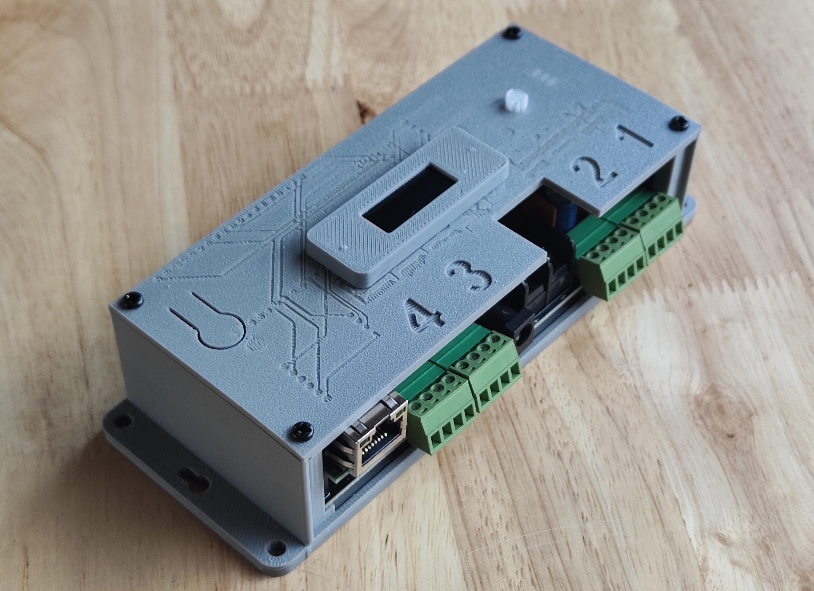
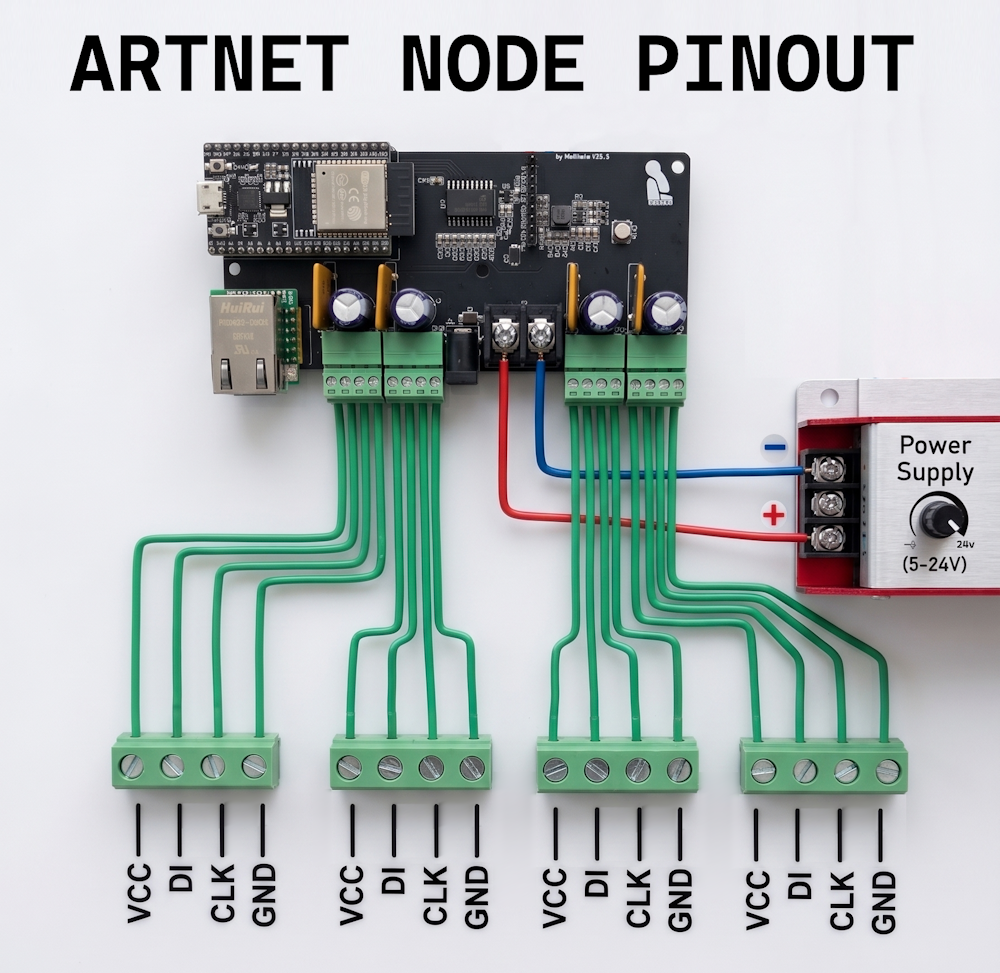
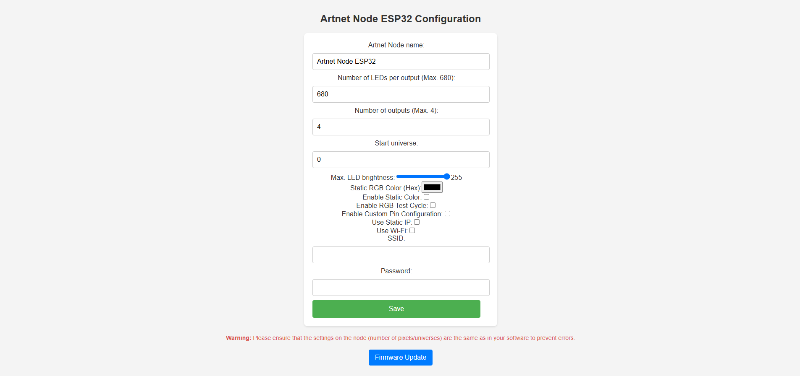

# ESP32-Artnet-Node-receiver

[](https://discord.gg/nNKYTJYVxf) Questions, builds and firmware updates: https://discord.gg/nNKYTJYVxf



This Art-Net ESP32 LED controller is a high-performance, open-source solution for controlling addressable LEDs over Ethernet or Wi-Fi. It drives up to four LED strips from Art-Net or sACN (E1.31) using an ESP32 with a W5500 Ethernet module, and is set up from a web page served by the node itself. An ESP32-ETH01 build exists as well, but the W5500 is the one to use: the ETH01 suffers from performance issues.

NOW FOR SALE: [https://www.etsy.com/nl/shop/LichtBit](https://lichtbit.etsy.com)

**Current firmware: 1.4.1**

### Videos & Tutorials
- Soldering tutorial: https://www.youtube.com/watch?v=-qxbHJJCwbM
- Node & Resolume Arena configuration: https://www.youtube.com/watch?v=1a7sWZTA7lg

## Contents

- [Features](#features)
- [Hardware](#hardware)
- [Firmware](#firmware)
- [Using the node](#using-the-node)
- [Basic Resolume setup example](#basic-resolume-setup-example)
- [WLED](#wled)
- [Open-source contributions](#open-source-contributions)
- [License](#license)

## Features

**Outputs and LEDs**
- 4 outputs with up to 6 universes each, 24 universes in total.
- 3-channel (RGB), 4-channel (RGBW) and 5-channel (RGBWW / RGBCCT) pixels.
- 3-wire LEDs (WS28xx) and 4-wire SPI-based LEDs (APA102 style).
- Pixels per fixture: group up to 16 LEDs into one addressable fixture, so long strips need a smaller patch.
- Brightness ceiling that caps the output in every mode, useful for limiting power draw.
- Frame rate follows strip length. WS2812 RGB runs at about 49 fps with 4 universes per output (680 LEDs) and about 32 fps with 6 (1020 LEDs).
- Reliable performance: 99%+ reliability with less than 1% dropped frames.

**Network and protocols**
- Art-Net, sACN (E1.31), or both at the same time.
- Ethernet (W5500) and Wi-Fi.
- AP mode to reach the node without an existing network.
- Fixed IP address for permanent installations. Subnet mask and gateway are optional and worked out for you when left blank.
- Node discovery: the web page lists the other Art-Net nodes on the network, with a link to each one.

**Web interface**
- Set the node name, link, protocol, first universe, universes per output, pixels per fixture, number of outputs, strip type, channels per pixel and data pins.
- Live settings: output mode, brightness ceiling, static colour and the display flip apply the moment you change them. Only the settings that need it ask for a restart.
- Built-in test outputs: static colour (with white levels for RGBW and RGBWW), RGB test cycle and a colour fade.
- Power and temperature monitoring on boards with the INA226 and NTC sensors: supply voltage, current, power, board temperature and an optional external temperature probe.
- Over-the-air (OTA) firmware updates.
- Light and dark theme.

**On the node**
- 128x32 OLED showing the node name, IP address and patch. It can be flipped for upside-down mounting.
- RGB status LED.
- Boot button to switch mode without a browser.
- Firmware version on the OLED and in the web page.

**Open hardware**
- Fully open-source, including the PCB design and BOM, so you can build your own cost-effective controller.

## Hardware

### Requirements

- ESP32-Wroom-Dev1 (or an ESP32-ETH01)
- W5500 Ethernet module
- LED strips (see [Supported LED ICs](#supported-led-ics))
- 128x32 OLED display (optional, for status feedback)
- WS2812 RGB status LED (optional)
- 12 V or 5 V power supply

**Important!** Only a few ESP32 boards are supported. Check [WebServer_ESP32_W5500](https://github.com/khoih-prog/WebServer_ESP32_W5500) for the supported boards when using the W5500.

### PCB design

The PCB uses 12 V to 5 V step-down converters, car fuses for protection and screw terminals for easy connections.

- Project: https://oshwlab.com/matthijsdethmers/artnetnode-esp32
- EasyEDA editor: https://easyeda.com/editor#project_id=86fd5b1121594bfa85fd2c5eed017e20

### Node pinout



| Function | Pin | Notes |
|---|---|---|
| LED data outputs 1-4 | 12, 14, 27, 26 | Can be changed in the web page under Hardware > Data pins. |
| Status LED | 16 | WS2812. |
| APA102 clock | 17 | Shared by all outputs. Newer board versions have this pin on the connector. |
| Level shifter OE | 25 | Must be LOW to enable the outputs. The firmware does this at boot. |
| OLED and INA226 (I2C) | 21 (SDA), 22 (SCL) | The INA226 address is found automatically. |
| On-board NTC | 35 | 10k, boards with monitoring only. |
| External NTC | 32 | 10k, optional. |
| Boot button | 0 | Mode switching. |

Notes:
- Pins 16 and 17 run through the 5 V level shifter. If you do not need the status LED or the APA102 clock, they can be repurposed in the code.
- There is a 5V switch where the 12 V regulator sits. Use it if you power the node with 5 V instead of 12 V. The ESP32 and the other logic are then fed from the 5 V supply instead of the 12 V to 5 V regulator.
- Boards with monitoring: the shunt value, NTC beta and divider layout are `#define`s at the top of the sketch (`INA226_SHUNT_OHMS`, `NTC_BETA`, `NTC_ON_HIGH_SIDE`). Boards without an INA226 show no Monitor panel.

The level shifter is enabled in `setup()` like this:
```
void setup() {
  Serial.begin(115200);

  pinMode(ShifterPin, OUTPUT);
  digitalWrite(ShifterPin, LOW);
```

### Supported LED ICs

All LEDs of the WSxxxx series and SPI-based APA102-style LEDs are supported, with 3, 4 or 5 channels. These include, but are not limited to:
- WS2805, WS2811, WS2812, WS2813, WS2814, WS2815 (tested)
- SPI-based APA102-style LEDs (tested)
- SK6812, SK6812W, SK6812-mini (not tested)
- GS8208, TM1814, TM1829, UCS8904, UCS8903, FW1906 (not tested)

### A note on a direct Ethernet connection between node and PC

The W5500 does not support Auto-MDI/MDIX, so you need a crossover cable to connect the node straight to your PC.

## Firmware

### Flash a ready-made binary

[`Bin/ESP32Wroom_W5500_Wifi_and_Ethernet.ino.bin`](Bin/ESP32Wroom_W5500_Wifi_and_Ethernet.ino.bin) is firmware 1.4.1 for the W5500 board. On a node that already runs this firmware, upload it through the web page (see [OTA updates](#ota-updates)).

For a new or erased ESP32, flash all four files in [`Bin`](Bin) over USB with [esptool](https://github.com/espressif/esptool) (`pip install esptool`). Run this from the `Bin` folder and replace `COM5` with your serial port:

```
python -m esptool --chip esp32 --port COM5 --baud 921600 write-flash -z --flash-mode dio --flash-freq 80m --flash-size 4MB 0x1000 ESP32Wroom_W5500_Wifi_and_Ethernet.ino.bootloader.bin 0x8000 ESP32Wroom_W5500_Wifi_and_Ethernet.ino.partitions.bin 0xe000 boot_app0.bin 0x10000 ESP32Wroom_W5500_Wifi_and_Ethernet.ino.bin
```

| Address | File | What it is |
| --- | --- | --- |
| `0x1000` | `ESP32Wroom_W5500_Wifi_and_Ethernet.ino.bootloader.bin` | Bootloader |
| `0x8000` | `ESP32Wroom_W5500_Wifi_and_Ethernet.ino.partitions.bin` | Partition table |
| `0xe000` | `boot_app0.bin` | OTA data, selects the first app slot |
| `0x10000` | `ESP32Wroom_W5500_Wifi_and_Ethernet.ino.bin` | Firmware |

If esptool cannot connect, hold the BOOT button while it starts. Saved settings survive a reflash; run `python -m esptool --chip esp32 --port COM5 erase-flash` first for a clean start.

### Build it yourself

The sketch is in [`Source/ESP32Wroom_W5500_Wifi_and_Ethernet`](Source/ESP32Wroom_W5500_Wifi_and_Ethernet).

- Arduino IDE with ESP32 support
- Espressif ESP32 board package
  - Use https://espressif.github.io/arduino-esp32/package_esp32_index.json
  - Version 2.0.17 or lower, otherwise compilation errors arise
- Libraries:
  - **WebServer_ESP32_W5500** https://github.com/khoih-prog/WebServer_ESP32_W5500
  - **I2SClocklessLedDriver** https://github.com/hpwit/I2SClocklessLedDriver (WS28xx output)
  - **I2SAPA102** https://github.com/hpwit/I2SAPA102 (APA102 output)
  - **FastLED** https://github.com/FastLED/FastLED (needed by I2SAPA102)
  - **FORKED artnetESP32V2** https://github.com/mdethmers/artnetesp32v2, version 1.1.1 or newer. 1.1.0 added the per-universe frame assembly and counters the firmware relies on; 1.1.1 fixes sACN reception.
  - **Adafruit_NeoPixel** (status LED and test outputs)
  - **Adafruit_GFX** and **Adafruit_SSD1306** (OLED)
  - Preferences, WebServer, WiFi, SPI, Wire and Update come with the ESP32 board package.
- Build with Tools > Core Debug Level set to **None**. The node prints its own receive and frame counters every 5 seconds regardless. "Info" adds the library's boot-time details (buffer allocation, multicast joins), but logging from the network path costs real throughput at high universe counts, so leave it on None for a show.

## Using the node

### Open the web interface



1. Connect the node to your network with Ethernet. It waits for a link for as long as it takes; there is no timeout.
2. Read the IP address from the OLED and open it in a web browser.
   - Without an OLED, Resolume's advanced output will autodetect the node and show its address.
3. No network yet? Put the node in [AP mode](#ap-mode) with the boot button.

### Settings

The page is laid out in setup order: Node, Patch, Hardware, Output.

Settings marked **Live** in the page are sent to the node as you change them and are stored when you let go of the control. For everything else, a **Save & restart** bar appears at the bottom of the page once you change one of them; the outputs go dark for a few seconds while the node restarts.

| Applied live | Applied after Save & restart |
|---|---|
| What the strips show (Live DMX, Static, RGB test, Fade) | Node name |
| Brightness ceiling | Link (Ethernet / Wi-Fi), Wi-Fi network and password |
| Static colour, white level, second white | Fixed address, subnet mask, gateway |
| Flip the display | Protocol and first universe |
| | Universes per output, pixels per fixture, outputs in use |
| | Strip type, channels per pixel, data pins |

Things to know:
- **Match the patch.** The universes, outputs and pixel counts on the node must match what your software sends. A mismatch can result in a black output. The universe map on the page shows exactly which universes each output listens on.
- **Universe numbering.** Art-Net counts universes from 0, sACN from 1. Enter the number your console shows.
- **Universes per output.** One universe carries 170 pixels in RGB, 128 in RGBW or 102 in RGBWW. An output takes 1 to 6 universes; a new node starts at 6. Every output begins on a universe boundary.
- **Pixels per fixture.** At 1 every LED is addressed on its own. At a higher value the console addresses one fixture and the node copies it across that many LEDs.
- **Test outputs.** Static, RGB test and Fade ignore incoming DMX. Set the output back to Live DMX when the rig is running.

### Mode switching with the boot button

A short press steps to the next mode and restarts the node:

Ethernet > Wi-Fi > AP mode > RGB test > Static colour > Firmware info > back to Ethernet

A long press (over a second) does something extra in some modes:

| Mode | Long press |
|---|---|
| Ethernet | Switch between fixed IP and DHCP. |
| RGB test | Switch between the RGB cycle and the colour fade. |
| Static colour | Enter colour selection. Short presses then step through 10 preset colours; another long press keeps the one showing. |

In Wi-Fi mode, set a fixed address from the web page.

To use your own preset colours, change this list before compiling:
```
const String presetColors[PRESET_COLORS_COUNT] = {
  "#FF0000", // Red
  "#00FF00", // Green
  "#0000FF", // Blue
  "#FFFF00", // Yellow
  "#FF00FF", // Magenta
  "#00FFFF", // Cyan
  "#FFFFFF", // White
  "#FF8000", // Orange
  "#8000FF", // Purple
  "#000000"  // Black/Off
};
```

### Status LED

| Colour | Meaning |
|---|---|
| Yellow | Booting |
| Blinking red | Waiting for a link |
| Steady green | Link up, no data arriving |
| Green with a short amber flash twice a second | Art-Net or sACN frames are arriving |
| Blue | AP mode |
| The static or fade colour | A test output is showing |

### AP mode

AP mode is the third stop of the boot button menu. The node then starts its own Wi-Fi network, named after the node, and serves the web page at 192.168.4.1. Use it to set up a Wi-Fi connection or to change settings where there is no network.

The node no longer falls back to AP mode by itself when Ethernet stays down.

### OTA updates


Open **Firmware update** at the bottom of the web page and upload the `.bin` file. The node restarts on the new firmware when the upload finishes. Handy when the node is in a hard-to-reach or remote place.

## Basic Resolume setup example

A basic setup for Resolume; other software works similarly.

1. Connect the node to a router (DHCP) or a switch (fixed IP) through Ethernet or Wi-Fi, or use AP mode (192.168.4.1).
2. Open the configuration page and set the node's name, the number of outputs and the universes per output your strips need.
3. Optional: set the output to RGB test or Static to check that all outputs and LEDs behave as expected. Set it back to Live DMX afterwards.
4. In Resolume, set the correct network adapter in Preferences > DMX.
5. In Resolume's advanced output, add a new Lumiverse and add the LED strips.
6. In Resolume's advanced output, set the IP address.
7. Give each output its own start universe. Every output takes the number of universes you set, and the next output starts right after it:

   | Universes per output | LEDs per output (RGB) | Start universe of output 1 / 2 / 3 / 4 |
   |---|---|---|
   | 6 (default) | 1020 | 0 / 6 / 12 / 18 |
   | 4 | 680 | 0 / 4 / 8 / 12 |

   The universe map on the configuration page shows the numbers for your own settings.
8. Your strips should now light up!

## WLED

Check this [YouTube video](https://www.youtube.com/watch?v=f3e7oMOB8D4) on how to install WLED!

I have forked WLED from the MoonModules project and have it working with the W5500 and the OLED screen on the node. If you need WLED on the node, check out this repo: [W5500_WLED](https://github.com/mdethmers/W5500_WLED)

### WLED Art-Net / sACN (E1.31)

To get Art-Net working on your WLED install, go to the Sync settings, set the network DMX input to Art-Net or sACN (E1.31) and the DMX mode to Multi-RGB. Make sure to reboot.

In the LED preferences, set the number of LEDs to match the universes you need (for example 340 for 2 universes per output; the maximum I got working was 510 LEDs / 9 universes). Set Resolume to send a number of universes equal to the number of outputs times the universes per output.

## Open-source contributions

This project is fully open-source! Feel free to contribute improvements, share your builds, and collaborate with the community.

## License

This project is released under the MIT License. You are free to use, modify, and distribute it with proper attribution.
